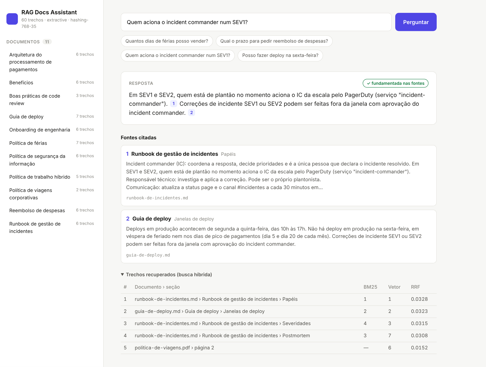
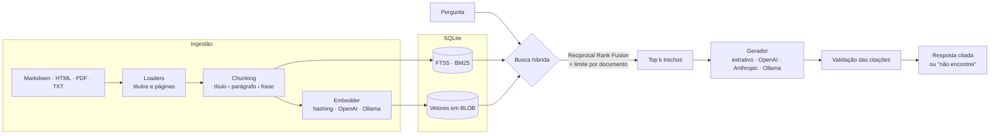

<div align="center">

# RAG Docs Assistant

**Assistente de perguntas sobre documentos internos: busca híbrida (BM25 + vetores), respostas sempre citadas, recusa quando a resposta não está nos documentos e avaliação automática da qualidade no CI.**

[](https://github.com/lucassantana2301-bot/rag-docs-assistant/actions/workflows/ci.yml)
[](https://github.com/lucassantana2301-bot/rag-docs-assistant/actions/workflows/codeql.yml)
[](https://lucassantana2301-bot.github.io/rag-docs-assistant/coverage/)
[](https://github.com/lucassantana2301-bot/rag-docs-assistant/releases)


**[📊 Relatório de avaliação ao vivo](https://lucassantana2301-bot.github.io/rag-docs-assistant/)** · [Abrir no Codespaces](https://codespaces.new/lucassantana2301-bot/rag-docs-assistant?quickstart=1) · [Releases](https://github.com/lucassantana2301-bot/rag-docs-assistant/releases) · [Arquitetura](#arquitetura) · [Decisões](#decisões-técnicas)



</div>

## O problema

Todo time tem as respostas escritas em algum lugar (política de férias, runbook de incidentes, guia de deploy), mas ninguém acha. Um chatbot comum responde com confiança mesmo quando inventa. Para documento interno isso é pior do que não responder: alguém vai pedir reembolso fora do prazo ou fazer deploy numa sexta-feira porque "a IA disse".

Este projeto responde **só com base nos documentos**, mostra **de onde tirou cada frase** e diz **"não encontrei"** quando a informação não está lá. A qualidade é medida por um conjunto de perguntas de referência a cada commit, como qualquer outro teste.

## Funcionalidades

- **Ingestão de Markdown, texto, HTML e PDF**, preservando o caminho de títulos (`Política de férias › Abono pecuniário`) e a página do PDF de cada trecho.
- **Chunking que respeita a estrutura**: divide por título, depois por parágrafo, depois por frase, com sobreposição entre chunks.
- **Busca híbrida**: BM25 (SQLite FTS5, sem acento e sem diferenciar maiúsculas) e similaridade vetorial, fundidos por **Reciprocal Rank Fusion**, com limite de trechos por documento.
- **Respostas com citação verificada**: citação que aponta para uma fonte inexistente é removida, e resposta sem nenhuma citação válida aparece como "sem fonte nos documentos".
- **Provedores plugáveis**:
  - embeddings: local por *feature hashing* (padrão, sem custo e sem rede), OpenAI ou Ollama;
  - respostas: extrativa sem LLM (padrão), OpenAI, Anthropic ou Ollama.
- **Proteção contra prompt injection** nos documentos: o conteúdo vai delimitado como dado, o documento não consegue fechar o bloco de fontes, e o prompt manda ignorar instruções que apareçam dentro dele.
- **Reindexação idempotente**: o mesmo arquivo não é reprocessado (nem reenviado ao provedor de embeddings, que cobra por token), e arquivo alterado substitui os chunks antigos sem deixar resultado "fantasma".
- **Avaliação automática** com hit rate, MRR, fidelidade das citações, presença dos fatos-chave e recusa de perguntas fora do escopo. O CI falha se a busca piorar.
- **API REST, interface web e CLI** (`rag ingest | ask | search | eval | serve`).

## Arquitetura



```
src/rag_docs/
├── loaders.py       # Markdown, HTML, PDF e texto → seções com caminho de títulos
├── chunking.py      # divisão por título, parágrafo e frase, com overlap
├── embeddings.py    # hashing local, OpenAI, Ollama (com retry e Retry-After)
├── store.py         # SQLite: FTS5 (BM25) + vetores, transações e reindexação
├── retrieval.py     # Reciprocal Rank Fusion e diversificação por documento
├── generation.py    # prompt, geradores, validação de citações
├── evaluation.py    # hit rate, MRR e métricas das respostas
├── service.py       # casos de uso
├── api.py           # FastAPI
├── cli.py           # linha de comando
└── web/             # interface (HTML, CSS e JS sem framework)
corpus/              # base de conhecimento de exemplo (empresa fictícia)
eval/golden.jsonl    # 38 perguntas de referência
```

## Como rodar

Pré-requisito: [uv](https://docs.astral.sh/uv/) (ou Docker).

> **Sem instalar nada:** [](https://codespaces.new/lucassantana2301-bot/rag-docs-assistant?quickstart=1) abre o projeto com o corpus indexado e a interface rodando.

Com a imagem publicada em cada release (SBOM e atestado de proveniência inclusos):

```bash
docker run -p 8000:8000 ghcr.io/lucassantana2301-bot/rag-docs-assistant:1
gh attestation verify oci://ghcr.io/lucassantana2301-bot/rag-docs-assistant:1 --owner lucassantana2301-bot
```

A partir do código:

```bash
uv sync
uv run rag ingest corpus
uv run rag ask "Posso fazer deploy na sexta-feira?"
```

```
Não há deploy em produção na sexta-feira, em véspera de feriado nem nos dias de pico de pagamentos (dia 5 e dia 20 de cada mês). [1]

[1] guia-de-deploy.md › Guia de deploy › Janelas de deploy
```

Interface web e API:

```bash
RAG_CORPUS_DIR=corpus uv run rag serve   # http://127.0.0.1:8000
# ou
docker compose up --build                # http://127.0.0.1:8000
```

Com um LLM (opcional):

```bash
export RAG_LLM_PROVIDER=anthropic RAG_LLM_MODEL=<modelo> RAG_ANTHROPIC_API_KEY=...
# ou RAG_LLM_PROVIDER=ollama RAG_LLM_MODEL=llama3.1 para rodar 100% local
```

Todas as variáveis estão em [`.env.example`](.env.example).

## API

| Método | Rota | Descrição |
| --- | --- | --- |
| `GET` | `/health` | status, quantidade de documentos e trechos, provedores |
| `POST` | `/api/ask` | `{"question": "...", "top_k": 5}` → resposta, citações e trechos recuperados |
| `GET` | `/api/search?q=&mode=hybrid\|lexical\|vector` | só a recuperação, para depurar |
| `GET` | `/api/documents` | documentos indexados |
| `POST` | `/api/documents` 🔒 | upload (multipart), idempotente |
| `DELETE` | `/api/documents/{id}` 🔒 | remove o documento e seus trechos |

🔒 exige `Authorization: Bearer <RAG_API_KEY>`. Sem a chave configurada, as rotas de escrita ficam desligadas. A documentação interativa fica em `/docs`.

## Avaliação

O arquivo [`eval/golden.jsonl`](eval/golden.jsonl) tem 34 perguntas com a fonte esperada e o fato-chave da resposta, e 4 perguntas cuja resposta não está nos documentos (o sistema precisa recusar). As perguntas usam palavras diferentes das do texto de propósito ("vender férias" para "abono pecuniário", "reverter uma versão" para "rollback").

```bash
uv run rag eval eval/golden.jsonl --answers --min-hit-rate 0.9
```

Resultado com a configuração padrão (embedding local por hashing e respostas extrativas, sem LLM):

| Modo | k | Hit rate | MRR |
| --- | --- | --- | --- |
| lexical | 5 | 97% | 0,898 |
| vetorial | 5 | 91% | 0,870 |
| híbrido | 5 | 97% | 0,866 |

| Respostas | Valor |
| --- | --- |
| Citam a fonte esperada | 85% |
| Contêm os fatos-chave | 65% |
| Recusam pergunta fora do escopo | 100% |

**Como ler esses números**:

- O embedding por hashing é léxico (palavras e pedaços de palavra). Ele captura variações de forma, como "reembolso" e "reembolsável", mas não sinônimos. Por isso o híbrido empata com o BM25 neste corpus pequeno.
- A pergunta que nenhum modo acerta é "Posso colar código no ChatGPT?": o documento fala em "ferramentas de IA generativa". É exatamente o caso que um embedding neural resolve. Com `RAG_EMBEDDING_PROVIDER=openai` ou `ollama`, a busca vetorial passa a pesar de verdade na fusão.
- A resposta extrativa copia frases do documento: nunca inventa, mas não junta informações de dois trechos. O LLM fecha essa diferença, e o mesmo comando mede o ganho.

O CI roda essa avaliação a cada commit e publica a tabela no resumo da execução. A cada push na `main`, o [relatório navegável](https://lucassantana2301-bot.github.io/rag-docs-assistant/) mostra, pergunta por pergunta, os trechos recuperados (com a posição no BM25 e no vetor), a resposta, as citações e o motivo de cada falha:

```bash
uv run rag eval eval/golden.jsonl --html relatorio/index.html --json-out relatorio/eval.json
```

## Decisões técnicas

- **SQLite com FTS5 e vetores no mesmo arquivo** ([ADR 0001](docs/adr/0001-sqlite-como-indice-hibrido.md)): um arquivo, zero serviço extra e transação única para texto e vetor, então nunca existe chunk com texto e sem vetor. A busca vetorial é exata e fica em cache. Para milhões de chunks, a interface `Store` é pequena o bastante para trocar por pgvector.
- **Reciprocal Rank Fusion em vez de soma de scores** ([ADR 0002](docs/adr/0002-busca-hibrida-com-rrf.md)): BM25 não tem teto e cosseno vai de -1 a 1. Somar exige calibrar pesos por corpus; o RRF usa só a posição e funciona sem ajuste.
- **Padrão offline e determinístico**: sem chave de API, o projeto roda, passa nos testes e é avaliado no CI com resultado reproduzível. Os provedores pagos são opcionais.
- **Recusar é uma resposta válida**: a pontuação mínima do gerador extrativo foi calibrada no golden set para recusar 100% das perguntas fora do escopo, mesmo que isso custe algumas respostas certas.

## Segurança

- Rotas de escrita com API key comparada em tempo constante; desligadas quando a chave não está configurada.
- Upload com limite de tamanho (o servidor lê no máximo o limite mais 1 byte e recusa o resto); apenas o nome do arquivo entra no índice (sem caminho da máquina de origem).
- Consulta do usuário nunca vai crua para o `MATCH` do FTS5: cada termo vira literal, o que neutraliza a sintaxe e evita erro ou injeção na busca.
- Texto dos documentos renderizado na interface só por `textContent`, com Content Security Policy sem `unsafe-inline`.
- Chaves de API como `SecretStr` e erros de provedor sem eco da requisição.
- Contêiner sem root, sistema de arquivos somente leitura e `no-new-privileges`; CodeQL para Python e JavaScript e Dependabot.

## Qualidade

```bash
uv run ruff check . && uv run ruff format --check . && uv run mypy && uv run pytest --cov
```

São 60 testes com 94% de cobertura: loaders (HTML com script e navegação, PDF com quebra de linha, arquivo corrompido), chunking, idempotência, injeção na busca, RRF, validação de citações, prompt injection, provedores com transporte HTTP simulado (retry, 401 sem retry, payload inesperado), API completa e os portões de qualidade da avaliação. O mypy roda em modo `strict` no código e nos testes.

## Limitações e próximos passos

- O PDF precisa ter texto: PDF escaneado é recusado com mensagem clara e exigiria OCR antes.
- Não há controle de acesso por documento: todos que acessam a API veem todos os documentos. Para uso real, o próximo passo é filtrar a busca pelo grupo do usuário (vindo do SSO).
- Reranqueamento com cross-encoder e expansão de consulta melhorariam o MRR, ao custo de latência.
- A resposta não é transmitida em streaming (SSE).

## Contribuindo

Veja o [guia de contribuição](CONTRIBUTING.md) (fluxo de branch, Conventional Commits e release), o [CHANGELOG](CHANGELOG.md) e a [política de segurança](SECURITY.md).

## Licença

[MIT](LICENSE) © Lucas Santana Santos
